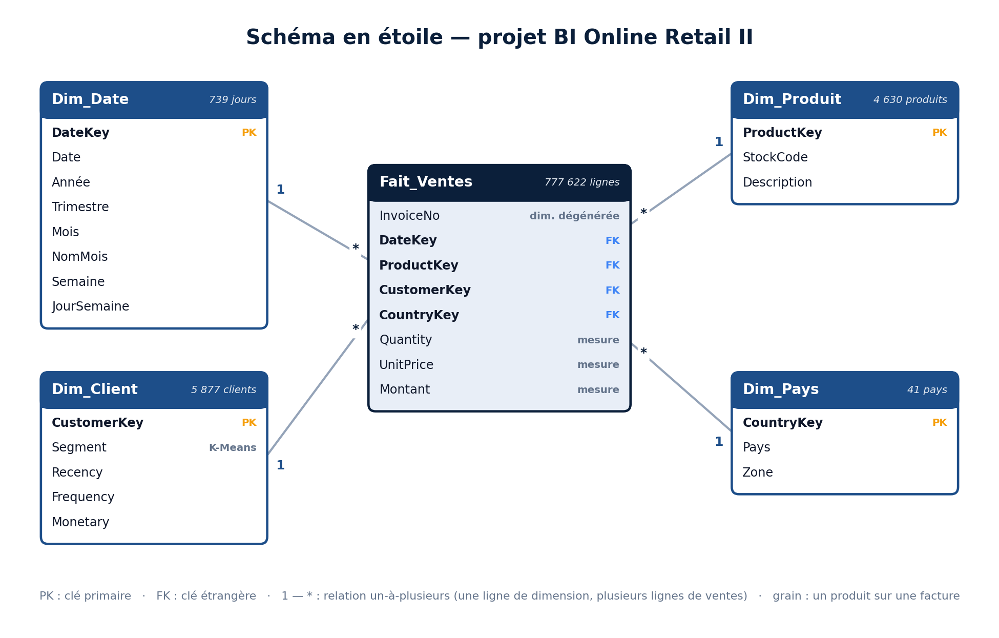

# Phase 2 — Modélisation multidimensionnelle

## 1. Du besoin au modèle

La phase 1 a défini les questions métier, les KPI et les axes d'analyse. Chaque axe devient une dimension du modèle, et chaque mesure alimente la table de faits.

| Axe d'analyse (phase 1) | Dimension | Question posée |
|---|---|---|
| Année, trimestre, mois | `Dim_Date` | Quand ? |
| Produit | `Dim_Produit` | Quoi ? |
| Client, segment | `Dim_Client` | Qui ? |
| Pays | `Dim_Pays` | Où ? |

Le modèle retenu est un **schéma en étoile** : une table de faits, `Fait_Ventes`, au centre, entourée de quatre dimensions.

## 2. Le grain

**Une ligne de `Fait_Ventes` correspond à une ligne de facture, c'est-à-dire à un produit sur une facture.**

Justification :
- C'est le niveau le plus fin disponible dans le fichier : on peut toujours regrouper des lignes détaillées (par facture, par mois, par pays), mais on ne peut pas détailler des lignes déjà regroupées.
- Le grain est identique à celui de la base nettoyée du projet ML : 777 622 lignes, ce qui permet de vérifier directement que le modèle ne perd ni ne duplique aucune ligne.

Vérification : 10 560 lignes (1,4 %) répètent un même couple (facture, produit), avec des quantités ou des prix différents. Ces lignes sont conservées : le couple (`InvoiceNo`, `StockCode`) n'est donc pas une clé unique, et la table de faits n'a pas besoin de clé propre.

## 3. Les faits (mesures)

| Mesure | Description | Additivité |
|---|---|---|
| `Quantity` | Quantité achetée sur la ligne | Additive : peut être sommée selon toutes les dimensions |
| `UnitPrice` | Prix unitaire en livres sterling | **Non additive** : une somme de prix unitaires n'a pas de sens ; on utilise au mieux une moyenne |
| `Montant` | `Quantity × UnitPrice`, montant de la ligne en livres sterling | Additive : sert à calculer le chiffre d'affaires |

La somme de `Montant` sur l'ensemble de la table doit donner **17 250 156,23 £**, valeur de référence de la phase 1.

## 4. Les dimensions

| Dimension | Lignes attendues | Attributs |
|---|---|---|
| `Dim_Date` | 739 (jours calendaires du 01/12/2009 au 09/12/2011) | `DateKey`, `Date`, `Année`, `Trimestre`, `Mois`, `NomMois`, `Semaine`, `JourSemaine` |
| `Dim_Produit` | 4 630 | `ProductKey`, `StockCode`, `Description` |
| `Dim_Client` | 5 877 | `CustomerKey`, `Segment`, `Recency`, `Frequency`, `Monetary` |
| `Dim_Pays` | 41 | `CountryKey`, `Pays`, `Zone` |

**Hiérarchies** (utilisées pour les opérations OLAP de la phase 4) :

| Dimension | Hiérarchie |
|---|---|
| `Dim_Date` | Année > Trimestre > Mois > Jour |
| `Dim_Client` | Segment > Client |
| `Dim_Pays` | Zone > Pays |
| `Dim_Produit` | Aucune : `StockCode` et `Description` ne forment pas une hiérarchie |

L'attribut **`Zone`** vaut « Royaume-Uni » ou « Export ». Il est justifié par le poids du Royaume-Uni (83,4 % du chiffre d'affaires) : il permet de répondre directement à la question métier « Royaume-Uni contre export ? » et de dérouler le détail des pays dans un second temps.

## 5. Les clés et les relations

| Dimension | Clé primaire | Type de clé | Clé étrangère dans `Fait_Ventes` |
|---|---|---|---|
| `Dim_Date` | `DateKey` | Entier au format AAAAMMJJ (par exemple 20110115) | `DateKey` |
| `Dim_Produit` | `ProductKey` | Clé de substitution (numéro créé par le modèle) | `ProductKey` |
| `Dim_Client` | `CustomerKey` | `Customer ID` converti en entier | `CustomerKey` |
| `Dim_Pays` | `CountryKey` | Clé de substitution | `CountryKey` |

Les clés de substitution rendent le modèle indépendant des codes d'origine (un `StockCode` peut porter plusieurs descriptions, un pays peut être renommé).

Chaque dimension est reliée à `Fait_Ventes` par une relation **un à plusieurs** : une ligne de dimension correspond à de nombreuses lignes de ventes.

## 6. Choix de conception justifiés

**Schéma en étoile plutôt qu'en flocon.** Les dimensions ne sont pas décomposées en sous-tables : le modèle reste simple, les requêtes et les relations Power BI sont directes, et aucune dimension n'a de hiérarchie assez profonde pour justifier un flocon.

**`InvoiceNo` dans la table de faits (dimension dégénérée).** Le numéro de facture n'a pas d'attribut propre (la date, le client et le pays sont déjà portés par les clés). Une table dédiée serait redondante ; le numéro sert à compter les factures.

**Le pays est rattaché aux faits et non au client.** Les vérifications montrent qu'aucune facture ne contient plusieurs clients ni plusieurs pays, mais que 13 clients (sur 5 877) ont acheté depuis deux pays différents. Le pays est donc stable à l'échelle de la facture, pas à celle du client : le rattacher aux faits évite d'attribuer à tort un client à un seul pays.

**Une description par produit : la plus fréquente.** 624 codes produit sur 4 630 (13,5 %) ont plusieurs descriptions dans le fichier (572 en ont deux, 44 trois, 8 quatre). On retient la plus fréquente pour obtenir une ligne unique par `StockCode`.

**Un calendrier continu.** Les ventes couvrent 604 jours, mais `Dim_Date` contient les 739 jours calendaires de la période. Les calculs temporels de Power BI (comparaison avec la période précédente) exigent une table de dates sans trou ; les 135 jours sans vente (par exemple week-ends et jours fériés) restent dans le calendrier avec un chiffre d'affaires nul.

**Le segment est un instantané.** `Segment`, `Recency`, `Frequency` et `Monetary` décrivent la situation à la date de référence du projet ML (10 décembre 2011). Le modèle ne conserve pas l'historique des changements de segment d'un client.

## 7. Vérifications effectuées

Résultats du notebook `02_data_validation` sur la base nettoyée :

| Vérification | Résultat | Conséquence pour le modèle |
|---|---|---|
| Nombre de lignes | 777 622 | Taille attendue de `Fait_Ventes` |
| Lignes répétant (`Invoice`, `StockCode`) | 10 560 | Le couple n'est pas une clé : on garde le grain « ligne de facture » |
| Factures avec plus d'un client | 0 | Le client peut être rattaché à chaque ligne sans ambiguïté |
| Factures avec plus d'un pays | 0 | Le pays est stable à l'échelle de la facture |
| Clients avec 1 pays / 2 pays | 5 864 / 13 | Le pays n'est pas un attribut du client |
| Produits distincts | 4 630 | Taille de `Dim_Produit` |
| `StockCode` avec 1 / 2 / 3 / 4 descriptions | 4 006 / 572 / 44 / 8 | Choix de la description la plus fréquente |
| Pays distincts | 41 | Taille de `Dim_Pays` |
| Jours avec des ventes | 604 sur 739 jours calendaires | `Dim_Date` doit être un calendrier continu |
| Quantité minimale / prix minimal | 1 / 0,001 £ | Valeurs strictement positives, aucun filtre supplémentaire |
| Valeurs manquantes | 0 | Aucune imputation nécessaire |

## 8. Limites du modèle

- Aucune catégorie de produits n'existe dans le jeu de données : la dimension produit n'a pas de hiérarchie, ce qui limite l'analyse par famille de produits.
- Certains prix unitaires sont extrêmement faibles (minimum de 0,001 £). Ils sont conservés, leur effet sur le chiffre d'affaires étant négligeable.
- Les retours, les annulations et les ventes sans identifiant client sont hors du modèle (voir le périmètre de la phase 1).
- Le segment K-Means est figé à une date : le modèle ne permet pas de suivre un client qui change de segment au fil du temps.